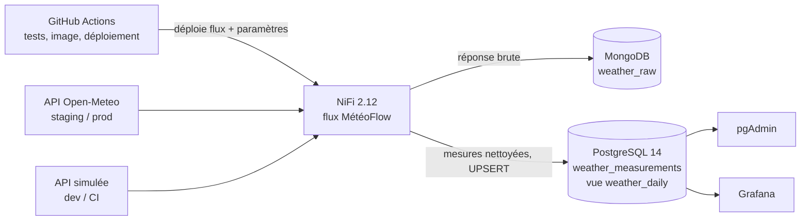

# MétéoFlow

Toutes les 15 minutes, Apache NiFi interroge l'API Open-Meteo pour plusieurs villes françaises, stocke la
réponse brute dans **MongoDB** et les mesures nettoyées dans **PostgreSQL 14**, consultables dans pgAdmin et
Grafana. Le tout est testé et déployé automatiquement par GitHub Actions (CI/CD).

## Architecture



## Le flux NiFi

```text
GenerateFlowFile (#{cities}, toutes les 15 min)
  → SplitJson ($.*)                       une FlowFile par ville
  → EvaluateJsonPath                      attributs city, lat, lon
  → InvokeHTTP  GET #{api_base_url}/v1/forecast?latitude=${lat}&longitude=${lon}&current=#{api_fields}
  → UpdateAttribute                       collected_at
       ├─► Jolt (enrichir)  → PutMongoRecord      → MongoDB weather_raw
       └─► Jolt (aplatir, heure en UTC)
              → EvaluateJsonPath (temperature)
                   ├─► ValidateRecord → QueryRecord (plages) → PutDatabaseRecord (UPSERT) → PostgreSQL
                   └─► RouteOnAttribute (temperature > #{alert_temp_max}) → LogAttribute « Alerte canicule »
  Erreurs (failure / retry / invalid / hors_plage) → LogAttribute « Erreurs »
```

- `#{...}` : **paramètre NiFi** (configuration), alimenté par `config/<env>.yaml`.
- `${...}` : **attribut de FlowFile** (donnée propre à chaque ville).
- Le flux est exporté en JSON (`flows/meteoflow.json`, format natif de NiFi 2) ; la configuration par
  environnement est en YAML. Aucune URL ni aucun mot de passe n'est écrit en dur dans le flux.

## Démarrer en local (dev)

```bash
cp .env.example .env
docker compose up -d --build
set -a; source .env; set +a
python scripts/deploy_flow.py --env dev      # déploie le flux dans NiFi
bash scripts/check_pipeline.sh dev           # vérifie l'arrivée des données
```

## Environnements et ports

| Service | dev | staging | prod |
| --- | --- | --- | --- |
| NiFi | https://localhost:8443/nifi | https://localhost:9443/nifi | https://localhost:10443/nifi |
| pgAdmin | http://localhost:5050 | http://localhost:5051 | http://localhost:5052 |
| Grafana | http://localhost:3000 | http://localhost:3001 | http://localhost:3002 |
| PostgreSQL | 5432 | 5443 | 5444 |
| MongoDB | 27018 (voir `.env`) | 27028 | 27029 |
| Source météo | API simulée | Open-Meteo | Open-Meteo |

Identifiants : `admin` (NiFi), `admin@meteoflow.fr` (pgAdmin), `admin` (Grafana). En dev, les mots de passe
sont dans `.env`. En staging et prod, ils viennent des secrets GitHub de l'environnement ; s'ils manquent,
le déploiement les génère une fois sur le runner dans `/root/meteoflow-secrets/<env>.env` :

```bash
wsl -d Ubuntu -u root -- cat /root/meteoflow-secrets/prod.env
```

## CI/CD

| Déclencheur | Ce qui se passe |
| --- | --- |
| Pull Request | `lint-tests` (ruff, yamllint, tests unitaires) puis `integration` : la stack démarre avec l'API simulée, le flux est déployé, `check_pipeline.sh` vérifie PostgreSQL et MongoDB |
| Merge sur `main` | CI, puis l'image NiFi est publiée sur GHCR et déployée en **staging** |
| Tag `v*.*.*` | CI, image, puis déploiement en **prod** après approbation manuelle (environnement `prod`) |
| Bouton « Run workflow » | Relance le pipeline CD à la main |

Les déploiements tournent sur un runner auto-hébergé dans **WSL Ubuntu** (Docker Desktop, intégration WSL).
Après un redémarrage du PC, relancer le runner :

```powershell
Start-Process wsl -ArgumentList '-d Ubuntu -u root -- bash /mnt/c/Users/jjsan/meteoflow/start-runner.sh'
```

## Démonstration

1. Ajouter une ville dans `config/staging.yaml`, par exemple `- { city: Bordeaux, lat: 44.84, lon: -0.58 }`.
2. `git commit` puis `git push` sur `main`.
3. Le pipeline CD redéploie staging ; dans pgAdmin de staging :

```sql
SELECT city, count(*) AS mesures, max(measured_at) AS derniere_mesure
FROM weather_measurements GROUP BY city ORDER BY city;
```

La nouvelle ville apparaît sans avoir touché au flux NiFi.

## Arborescence

```text
docker-compose.yml        stack (NiFi, PostgreSQL 14, MongoDB, pgAdmin, API simulée, Grafana)
nifi/Dockerfile           image NiFi 2.12 + pilote PostgreSQL
mock-api/                 API météo simulée (format Open-Meteo)
sql/                      schéma et vue weather_daily
flows/meteoflow.json      flux NiFi exporté
config/                   paramètres par environnement (dev, local, staging, prod)
env/                      ports et réglages des stacks staging / prod
grafana/                  source de données et tableau de bord provisionnés
scripts/                  deploy_flow.py (API REST NiFi), check_pipeline.sh
tests/                    tests unitaires
.github/workflows/        ci.yml, cd.yml, deploy.yml
```
